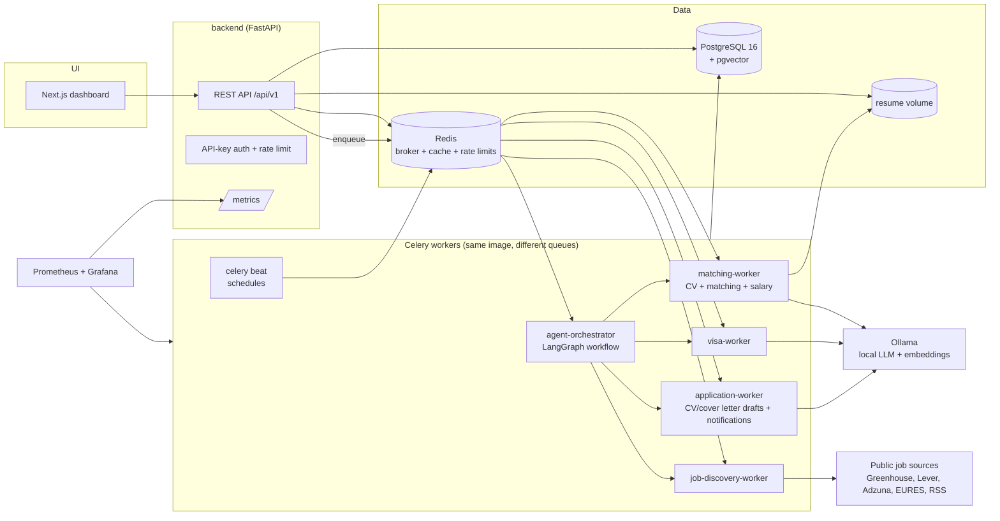
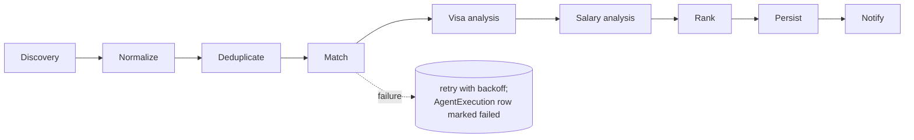
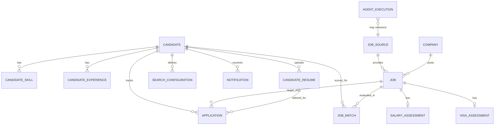

# Architecture

EU Job Intelligence is a self-hosted, single-tenant platform that discovers European
cloud-architecture jobs, scores them against a candidate profile, assesses visa
sponsorship and compensation evidence, and prepares (never submits) applications.

## 1. System overview



### Agent workflow (LangGraph, Phase 3)



Every node writes an `agent_executions` row (status, duration, items, token usage,
decisions). Each analysis result carries an `input_hash`; a node skips the LLM call when
the hash of (job content + candidate profile + analyzer version) has not changed. This
is how repeated LLM calls are avoided and how "reprocess this job" works: clear the hash
or pass `force=True`.

## 2. Service responsibilities

| Service | Responsibility | Scales by |
|---|---|---|
| `frontend` | Next.js dashboard: overview, job explorer, job details, profile, application tracker, agent monitor. The browser calls `/backend/*` on the same origin, which Next.js forwards to the API. The API key stays in the browser; the frontend holds no secret. | replicas (stateless) |
| `backend` | REST API, validation, auth, rate limiting, file uploads, audit log, enqueuing work. No LLM calls inline. | replicas (stateless) |
| `agent-orchestrator` | Runs the LangGraph pipeline per discovery batch; owns workflow state, retries, decision log. | 1–2 replicas |
| `job-discovery-worker` | Connectors (Greenhouse, Lever, Adzuna, EURES, RSS); robots.txt + rate limits; normalization, dedup, expiry. | replicas / queue `discovery` |
| `matching-worker` | CV parsing, embeddings, deterministic + semantic scoring, salary analysis. | replicas / queue `matching` |
| `visa-worker` | Rule-based evidence extraction + LLM classification into the 5 visa categories. | replicas / queue `visa` |
| `application-worker` | Drafts tailored CVs, cover letters, outreach, interview prep; sends notifications (email/Telegram). Drafts only, never submits. | queue `application` |
| `postgres` | System of record, pgvector for job/CV embeddings. | vertical |
| `redis` | Celery broker/result backend, rate-limit counters, short-lived caches. | vertical |
| `ollama` | Local chat model + embedding model. No paid APIs by default. | vertical (RAM/GPU bound) |
| `prometheus`/`grafana` | Metrics scraping and dashboards. | n/a |

The workers all run the same Python image with a different `celery -Q <queue>` command.
That keeps one codebase and dependency set while still allowing independent scaling. This
is a deliberate choice against one-image-per-agent microservices.

## 3. Code layout and boundaries

```
eu-job-intelligence/
├── common/               # settings (pydantic-settings), JSON logging, shared enums
├── database/
│   ├── models/           # SQLAlchemy 2.0 typed models (one module per aggregate)
│   ├── migrations/       # Alembic (async env)
│   └── session.py        # async engine / session factory
├── backend/
│   ├── main.py           # FastAPI app factory
│   ├── api/routes/       # routers: health, candidate, jobs, applications, ...
│   ├── schemas/          # Pydantic request/response models
│   ├── services/         # business logic used by routes (DI via Depends)
│   └── security.py       # API-key auth, rate limiter, upload validation
├── connectors/           # job-source connectors (Phase 2)
├── agents/
│   ├── orchestrator/     # LangGraph graph + state (Phase 3)
│   ├── discovery/        # Phase 2
│   ├── cv_intelligence/  # Phase 3
│   ├── matching/         # Phase 3
│   ├── visa_intelligence/# Phase 3
│   ├── salary_intelligence/ # Phase 3
│   └── application/      # Phase 3
├── workers/              # Celery app + task routing
├── frontend/             # Next.js (Phase 4)
├── infrastructure/
│   ├── docker/           # Dockerfiles
│   ├── kubernetes/       # k3d cluster config + raw manifests (Phase 5)
│   └── helm/             # Helm chart (Phase 5)
├── monitoring/           # Prometheus + Grafana provisioning (Phase 6)
├── tests/{unit,integration}
├── scripts/              # seed, backup, restore
├── data/sample/          # sample candidate + sample jobs (fictional)
├── docs/
├── docker-compose.yml
├── alembic.ini
├── pyproject.toml
└── .env.example
```

Dependency direction: `backend`, `agents`, `workers` → `database` → `common`.
`connectors` depend only on `common` and return plain Pydantic `RawJob` objects, so a
connector can be tested without a database.

## 4. Data model



Key design points:

- **Unknown is a first-class value.** Work authorization, citizenship, relocation and visa
  needs are nullable and default to *unknown*. Nothing downstream may assume a value.
- **Actual vs estimated salary** live in separate columns of `salary_assessments`
  (`actual_*` vs `estimated_*`), with an `assumptions` JSON blob for every estimate.
- **Visa evidence** is stored as a list of `{url, quote, signal}` objects. A
  classification without evidence is only allowed for "sponsorship not mentioned".
- **Deduplication**: `jobs` has `UNIQUE(source_id, external_id)` for exact re-ingestion,
  plus `dedup_hash` (normalized company + title + country + city) to collapse the same
  role posted through several sources.
- **Expiry**: `last_seen_at` is bumped on every discovery run; jobs not seen for
  `JOB_EXPIRY_DAYS` (or past `expires_at`) are marked `expired`.
- **Embeddings**: `vector(768)`, matching `nomic-embed-text`. HNSW indexes with cosine
  distance on `jobs.embedding` and `candidate_resumes.embedding`.
- **Audit**: every mutating API call writes an `audit_logs` row.

## 5. Infrastructure requirements

| Component | Version | Notes |
|---|---|---|
| Docker Desktop / Engine | 24+ with Compose v2 | Required for Phases 1–4 |
| PostgreSQL | 16 (`pgvector/pgvector:pg16`) | pgvector 0.7+ |
| Redis | 7 | broker + rate-limit storage |
| Ollama | 0.4+ | containerised, or native on macOS (see below) |
| Python | 3.12 | only needed for running tests outside containers |
| Node.js | 20 LTS | only needed for frontend dev outside containers |
| k3d **or** kind, kubectl, Helm 3 | latest | Phase 5 only |

## 6. Local hardware requirements

LLM inference dominates resource use. Everything except Ollama fits in about 2.5 GB RAM.

| Profile | RAM free for Docker | Model choice | Expected speed (CPU) |
|---|---|---|---|
| Minimum | 6 GB | `llama3.2:3b` + `nomic-embed-text` | ~5–15 tok/s, ~30–90 s per job analysis |
| Recommended | 12–16 GB | `qwen2.5:7b` or `llama3.1:8b` + `nomic-embed-text` | ~3–8 tok/s CPU; fast with GPU |
| With NVIDIA GPU (Linux) | 8 GB VRAM | 7–8B models | 30–80 tok/s |

**Apple Silicon note:** Docker containers on macOS cannot use the Metal GPU. Ollama in a
container on a Mac is CPU-only and limited by the Docker Desktop memory setting. The
recommended setup on a Mac is to run Ollama natively (`brew install ollama`) and point the
stack at it with `OLLAMA_BASE_URL=http://host.docker.internal:11434`. The compose file
supports both modes (the `ollama` service sits behind the `ollama` profile).

**This development machine** (8 GB total, Docker Desktop limited to 4 GB) is at the
minimum profile. Use native Ollama with `llama3.2:3b` and keep Docker for the rest.

The scoring engine does not depend on the LLM. Deterministic skill/seniority/location/
salary scoring plus embedding similarity produce a full score. The LLM adds narrative
reasons and visa-text classification, and the system degrades gracefully when Ollama is
unavailable.

## 7. Security model (single-tenant, self-hosted)

- API authentication: `X-API-Key` header checked in constant time against `API_KEYS`
  (comma-separated, from env/Secret). Health and metrics endpoints are unauthenticated.
- Rate limiting: per-key/IP via SlowAPI backed by Redis.
- Uploads: PDF/DOCX only, verified by magic bytes rather than extension, size capped by
  `MAX_UPLOAD_MB`, and stored under random names outside any web root.
- No credentials in code or images. Everything comes from `.env` (Compose) or Secrets (k8s).
- Connectors respect robots.txt, per-source rate limits and published ToS. They never
  log in, solve CAPTCHAs or evade bot detection. Playwright is used only for sources that
  are explicitly enabled and permit automation.
- Human-in-the-loop: applications, outreach messages and profile changes produced by
  agents are stored as drafts with `approved_at = NULL`. Nothing is sent or submitted.
